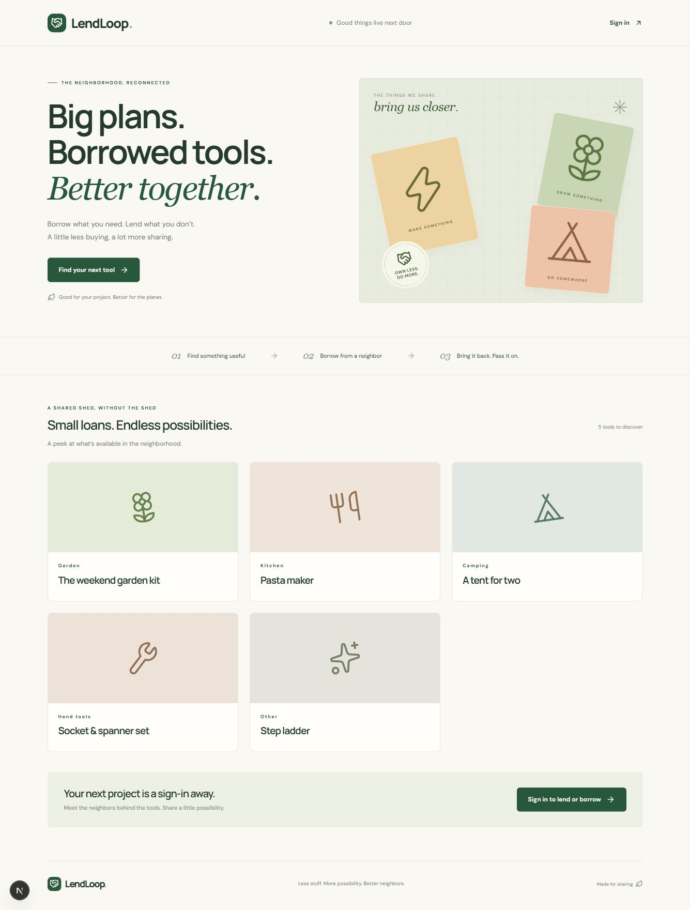
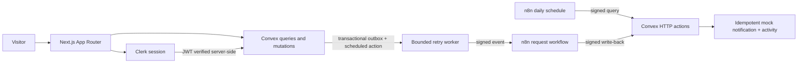

# LendLoop

**Borrow what you need. Lend what you don’t.** A neighborhood tool library built for the [Fluence full-stack take-home](https://remotive.com/remote-jobs/software-development/full-stack-developer-2091165).

Next.js App Router · TypeScript · Clerk · Convex · n8n. Notifications intentionally use a **durable logged mock channel**, which the brief permits. No email, Slack or Discord accounts are required. Mock delivery creates an addressed notification record in Convex and appears in loan activity; it does not send a real email.



## Run locally

Use Node.js 22 LTS or newer, npm, Docker Desktop, and free Clerk and Convex development projects. Commit the lockfile and install with `npm ci`. Installation does not require production credentials.

```sh
npm ci
cp .env.example .env.local
npm run setup:secrets
```

In PowerShell use `Copy-Item .env.example .env.local` instead of `cp` if preferred. The secret generator writes `.env.n8n` once, refuses to overwrite it, and never prints values.

### 1. Clerk

Create a development application at https://dashboard.clerk.com (email authentication is enough). Set `NEXT_PUBLIC_CLERK_PUBLISHABLE_KEY` and `CLERK_SECRET_KEY` in `.env.local`. Activate Clerk’s **Convex integration** and note its Frontend API URL. If using an older Clerk application with JWT templates, configure the `convex` template according to the current provider documentation.

Alternatively the official Clerk CLI supports provisioning a claimable development app with `npx clerk@latest init`. Review its changes to existing project files. A compatible JWT-template configuration is included in `scripts/clerk-convex-template.json`; on a fresh linked development app without a `convex` template, create it with `npx clerk@latest api /jwt_templates --file scripts/clerk-convex-template.json --yes`. Do not create a duplicate if the integration is already active. Keep secret keys out of commits, screenshots and chat.

### 2. Convex

```sh
npx convex dev
```

Create/select a development project. The CLI writes `CONVEX_DEPLOYMENT` and `NEXT_PUBLIC_CONVEX_URL` to `.env.local` and generates `convex/_generated`. Set the backend issuer before the first successful push:

```sh
npx convex env set CLERK_JWT_ISSUER_DOMAIN https://YOUR-CLERK-INSTANCE.clerk.accounts.dev
```

If the first push reports a missing issuer, set it in a second terminal and rerun. The Convex backend **does not read Next.js `.env.local` variables**. Set these in the Convex dashboard or with `npx convex env set`:

| Convex variable | Value |
| --- | --- |
| `CLERK_JWT_ISSUER_DOMAIN` | Exact Clerk Frontend API URL; no path or trailing slash |
| `N8N_WEBHOOK_URL` | Reachable n8n production webhook, ending `/webhook/lendloop-request` |
| `CONVEX_TO_N8N_SECRET` | Same random value as `.env.n8n` |
| `N8N_TO_CONVEX_SECRET` | Same random value as `.env.n8n`; different from the other direction |

Use the dashboard for secrets rather than putting their values into shell history. `.env.n8n` is ignored by Git. The application never exposes integration secrets through `NEXT_PUBLIC_*` variables.

Account-free local Convex development is also supported by the CLI: set `CONVEX_AGENT_MODE=anonymous` for `npx convex dev`. That downloads a backend binary and uses local ports 3210 (client) and 3211 (HTTP actions). Once configured, `node scripts/configure-local-backend.mjs` derives the issuer from the local Clerk publishable key and copies integration secrets to the local backend via stdin without printing them. This helper refuses cloud URLs. The default local admin endpoint is for development only; never expose it publicly.

### 3. n8n

Set `CONVEX_SITE_URL` in `.env.n8n` to the deployment’s **`.convex.site` HTTP-action URL**, not `.convex.cloud`. For local Convex on the host use `http://host.docker.internal:3211` inside Docker.

```sh
docker compose --env-file .env.n8n up -d
docker compose --env-file .env.n8n exec n8n n8n import:workflow --separate --input=/workflows
```

Open http://localhost:5678 and finish n8n’s local owner-account setup. Imported workflows start inactive. In each request/reminder workflow’s **Settings → Error workflow**, select **LendLoop — visible automation failures**, verify the timezone is UTC, then **publish all three workflows**, including the error-trigger workflow. The error workflow has no schedule, but the pinned n8n version requires it to be published to execute. If an import changes IDs, reselect the error workflow; do not assume an exported ID survived.

| Workflow | Trigger / behavior |
| --- | --- |
| `n8n/workflows/request-notifications.json` | POST webhook → verify HMAC → signed HTTP request → durable mock notification |
| `n8n/workflows/overdue-reminders.json` | Daily 09:00 UTC → signed overdue query → one signed mock reminder/write-back per overdue loan |
| `n8n/workflows/automation-errors.json` | Error Trigger → safe failure reference in execution history and container logs |

The webhook waits for the last node; it does not acknowledge before signature verification or durable delivery. Use the **production** webhook path. The test webhook path is intentionally not accepted by the signature verifier.

**Networking:** Cloud Convex cannot reach your computer’s `localhost`. For a cloud backend, expose only the n8n webhook through a TLS tunnel or host n8n on an HTTPS domain, then update `N8N_WEBHOOK_URL` in Convex. Keep the n8n editor authenticated and private. A local Convex backend can call `http://localhost:5678/webhook/lendloop-request` directly. Compose publishes the editor only on loopback. The workflow’s fixed path is part of the signature; if changing it, update the verifier too.

This Compose file is a dedicated local assessment instance using n8n’s internal JavaScript task runner. `crypto` is explicitly allowed and environment access is enabled for the signed integration. Treat workflow editors as trusted operators: they can access its secrets. For production use external task runners, scoped credentials, and the hardening described below. Cloud n8n restricts environment access; these exports target the provided self-hosted setup.

### 4. Start the app

```sh
npm run dev
```

Open http://localhost:3000. A setup screen appears if app credentials are missing; it never substitutes fake data for Convex. Sign up as two different neighbors (use separate browser profiles or sign out between users), list a tool, request it, approve it and mark it returned. Before the first authenticated query, the app creates a minimal profile in Convex.

To enable admin for a known Clerk user who has signed in once:

```sh
npx convex run users:setRole '{"subject":"user_REPLACE_WITH_CLERK_USER_ID","role":"admin"}'
```

This function is **internal**, reachable only through the operator CLI/dashboard, never through the browser API. User profiles always start with role `user`; no client-supplied metadata can promote them. Use the Admin tab to inspect all loans, moderate listings, and assign Trusted Lender badges. Admins cannot approve someone else’s requests or edit someone else’s listing.

## Verification

```sh
npm test
npm run typecheck
npm run lint
npm run build
```

Tests execute real Convex function handlers with `convex-test`, exercise the HTTP router, and execute the JavaScript shipped inside n8n’s exports. They cover authorization, data projection, date collisions, transitions, moderation, notification deduplication, overdue rules and signature forgery/replay windows. They do not replace a live Clerk login or a real n8n execution. See [the acceptance checklist](docs/acceptance.md) for that walkthrough and [the verification record](docs/verification.md) for what was actually run.

`npm run workflows` regenerates the three exports from the readable generator in `scripts/generate-workflows.mjs`. No service credentials are serialized. Package versions and the n8n image are pinned for reproducibility.

## Architecture and decisions



- **Convex is the authority.** Every authenticated query/mutation checks verified identity and ownership. Hiding controls in React is only a convenience. Public tool results contain exactly `name` and `category`; user IDs, loan IDs, owner details and descriptions are never returned publicly.
- **Minimal profiles:** Clerk subject, display name, role, trust badge. No copied email, address, phone number, access token or password. Other users’ Clerk subjects are never returned in views.
- **Dates are inclusive UTC calendar dates.** Return by the end of the final day. Shared boundary dates conflict. Loans last at most 30 days and start within 180 days. Approval checks conflicts inside a transaction, so concurrent approvals cannot double-book. Conflicting pending requests are declined with their own notification events. An overdue loan keeps a tool unavailable until explicitly returned.
- **Day-aware caching:** availability and loan queries take an explicit UTC day, refreshed by the browser every 30 seconds. The daily automation HTTP action supplies the server’s current day. Query-cache entries therefore advance at midnight even if no document has changed; mutations always recheck dates against server time.
- **State machine:** `pending → approved | declined | cancelled`; `approved → returned`. Only lenders decide requests; only borrowers cancel pending requests. Either participant can mark an approved loan returned once its start date arrives. Terminal states cannot be reversed.
- **Moderation:** removal soft-deletes listings and cancels pending requests. Owners must resolve approved loans first. Admin removal can immediately hide a problematic listing while keeping approved loans visible, returnable and eligible for reminders. History is retained for the assessment; production needs retention and erasure policies.
- **Reliable events:** mutations commit an outbox event and schedule delivery atomically. The worker uses a 20-second timeout, exponential delays, five attempts, and a durable failed state with UI retry. A 2xx is accepted only after the workflow records a mock notification. n8n HTTP nodes retry three times. n8n’s failed executions/error workflow and the app’s failed-delivery activity make failures visible.
- **Signed integration in both directions:** HMAC-SHA256 with independent random secrets, five-minute timestamp window, method and endpoint binding, and signed base64 UTF-8 JSON. Signing the base64 payload avoids JSON-key ordering and webhook raw-body discrepancies. Convex uses Web Crypto verification; n8n uses constant-time buffer comparison. TLS remains required outside local development.
- **Retry safety:** request notifications use `event:<eventId>`; reminders use `reminder:<loanId>:<UTC day>`. The uniqueness check and mock delivery record are in one Convex transaction. Signed requests can be replayed during the five-minute window, but writes are idempotent. Repeated overdue reads have no side effects. A reminder rechecks loan state when writing, so a concurrent return prevents stale reminders.
- **Data minimization:** the request workflow receives only an event ID; the overdue workflow receives only loan IDs and the UTC reminder day. Callbacks carry those same minimal references. Convex resolves recipients and loan details inside its trusted backend when recording the logged mock delivery. Names, contact details, categories, descriptions, statuses and due dates do not need to cross into n8n. Successful notification/reminder execution payloads are not retained. The error workflow retains its failure reference for inspection, and execution history is pruned after 48 hours. Application error messages omit bodies and secrets. Nothing here is a claim of healthcare compliance.

## Production changes

1. Use separate staging/production Clerk and Convex projects, TLS for every nonlocal endpoint, restricted origins, session policies and MFA for admins. Deploy Next.js with a reviewed Content Security Policy that includes the required Clerk/Convex origins.
2. Replace the mock sink with a provider that accepts an idempotency key. A non-idempotent email API creates a delivery/write-back crash window; do not claim exactly-once external email. Add a provider delivery ledger and reconciliation.
3. Run n8n behind authenticated administration, with Postgres, backups, external isolated task runners and scoped secret storage. Rotate both HMAC secrets with overlapping key IDs. Alert an operator on failed executions and outbox exhaustion.
4. Add pagination, indexed availability projections, request rate limits per identity and webhook ingress limits. Current whole-board queries intentionally suit a small take-home dataset, not an unbounded marketplace. Add a periodic outbox reconciler for failed scheduled actions.
5. Define privacy notices, retention/erasure/export rules, safe audit logging, moderation and abuse handling. Limit display-name visibility and never collect location until there is a justified product need. Accessibility and multi-user browser verification should be part of release acceptance.

## Submission

The deliverable is this source repository, exported workflows, setup/architecture/security documentation, and the production note above. A deployment is useful for review but is not required by the posting. [Application draft](docs/application-draft.md) contains placeholders for the candidate’s real portfolio and identity; it is not sent automatically.
